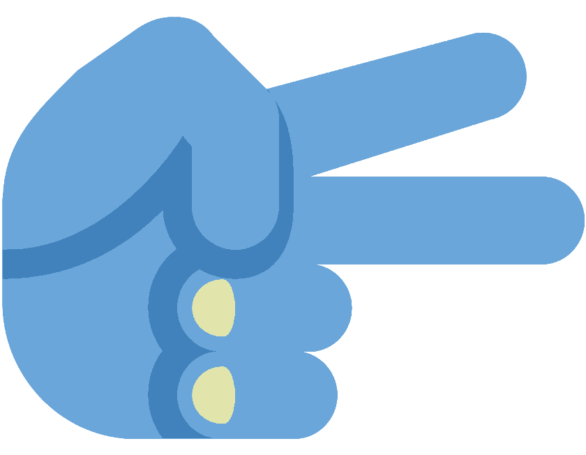

# ✂️ SliceMyBanner

> **The Simple Instagram Grid & Reel Cover Slicer for Canva**  
> Seamlessly calculate dimensions, slice multi-tile panoramas, preview on an interactive Instagram phone mockup, and export ready-to-post tiles in a single ZIP.



---

## ✨ Features

- 📐 **Sizing Blueprint & Canva Dimension Calculator**:
  - **1:1 Square Grids** (1080 × 1080 per tile) — 1 to 5 rows (3 to 15 posts)
  - **4:5 Portrait Feeds** (1080 × 1350 per tile) — Max vertical screen real estate
  - **9:16 Reel Cover Grids** (1080 × 1920 per tile) — Seamless 3-across video banner covers
  - One-click copy for exact Canva custom dimensions (Width × Height).

- 🔒 **100% Client-Side & Private**:
  - All image slicing, canvas cropping, and zip generation happen directly in the browser via HTML5 Canvas and Web APIs.
  - Zero server uploads — your images never leave your device.

- 📱 **Interactive Instagram Smartphone Simulator**:
  - Live preview of your profile grid before posting.
  - Test profile layout, reels tab, and feed view.
  - Light & dark mode toggle for accurate aesthetics.

- ⚡ **Slicer Controls & Batch Export**:
  - Visual slice preview with reverse/chronological post numbering.
  - High-res PNG ZIP packaging with an included sequential posting guide text file.
  - Individual tile downloads or one-click complete ZIP export.

- 🎨 **Modern Minimal Aesthetic**:
  - Editorial palette inspired by WW/Studio: Warm Canvas (`#FBFBF8`), Mist (`#DBE3E9`), Cornflower Blue (`#6AA6DA`), and Pear Chartreuse (`#E1E5AC`).
  - Native fluid smooth scrolling and fully responsive mobile layout.

---

## 🚀 Getting Started

### Prerequisites

- Node.js (v18 or higher recommended)
- npm or pnpm or yarn

### Installation

```bash
# Clone the repository
git clone https://github.com/NotAl2/SliceMyBanner.git

# Navigate to project directory
cd SliceMyBanner

# Install dependencies
npm install

# Start development server
npm run dev
```

Open [http://localhost:5173](http://localhost:5173) in your browser.

### Building for Production

```bash
# Type check and build
npm run build

# Preview production build
npm run preview
```

---

## 🛠️ Tech Stack

- **Framework**: [React 19](https://react.dev/) + [TypeScript](https://www.typescriptlang.org/)
- **Bundler**: [Vite 6](https://vitejs.dev/)
- **Styling**: [Tailwind CSS v4](https://tailwindcss.com/)
- **Icons**: [Lucide React](https://lucide.dev/)
- **Animation**: [GSAP](https://greensock.com/gsap/) + [Canvas-Confetti](https://www.npmjs.com/package/canvas-confetti)
- **ZIP Packaging**: [JSZip](https://stuk.github.io/jszip/)

---

## 💡 How to Use with Canva

1. **Calculate Dimensions**: Choose your grid format (Square, Portrait, or Reel Cover) and number of rows in **Step 1**.
2. **Create in Canva**: Click the **Copy** button to copy dimensions (e.g. `3240 × 1080 px`), create a custom size canvas in Canva, and design your banner panorama across the entire canvas.
3. **Download from Canva**: Export your completed design from Canva as a high-quality PNG or JPG.
4. **Upload & Slice**: Drop your image into **Step 2** of SliceMyBanner.
5. **Preview & Simulator**: Review the individual tiles and preview how your profile grid will look in the phone simulator.
6. **Download ZIP**: Click **Download ZIP** and upload the numbered tiles to Instagram starting from the highest number (e.g. `tile_03` down to `tile_01`) so your banner displays in correct order!

---

## 📄 License

MIT License © 2026 SliceMyBanner
